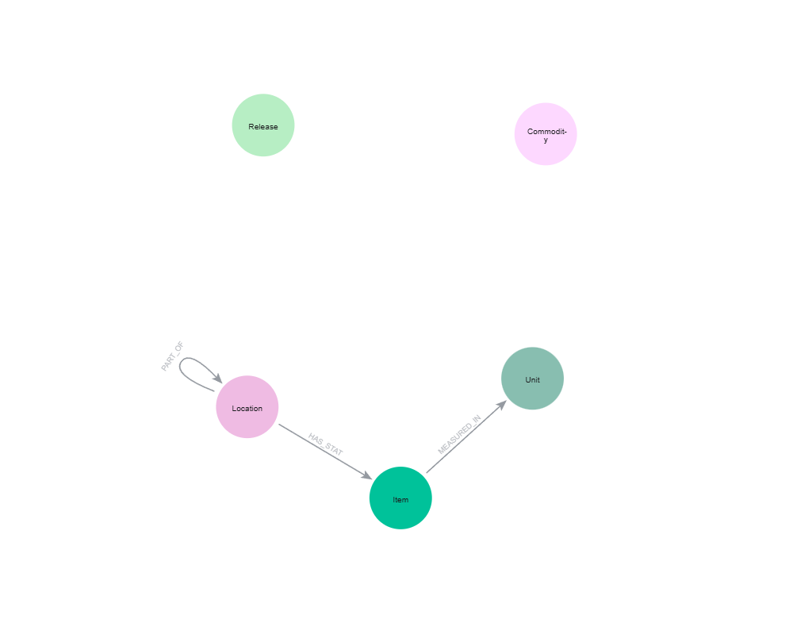
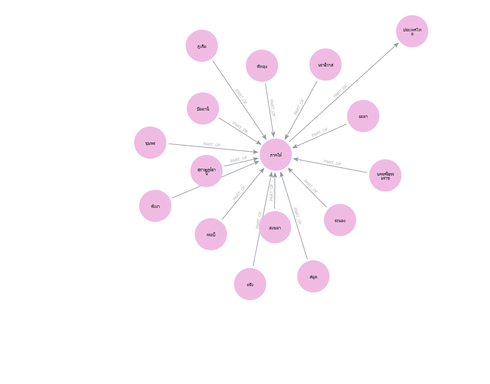
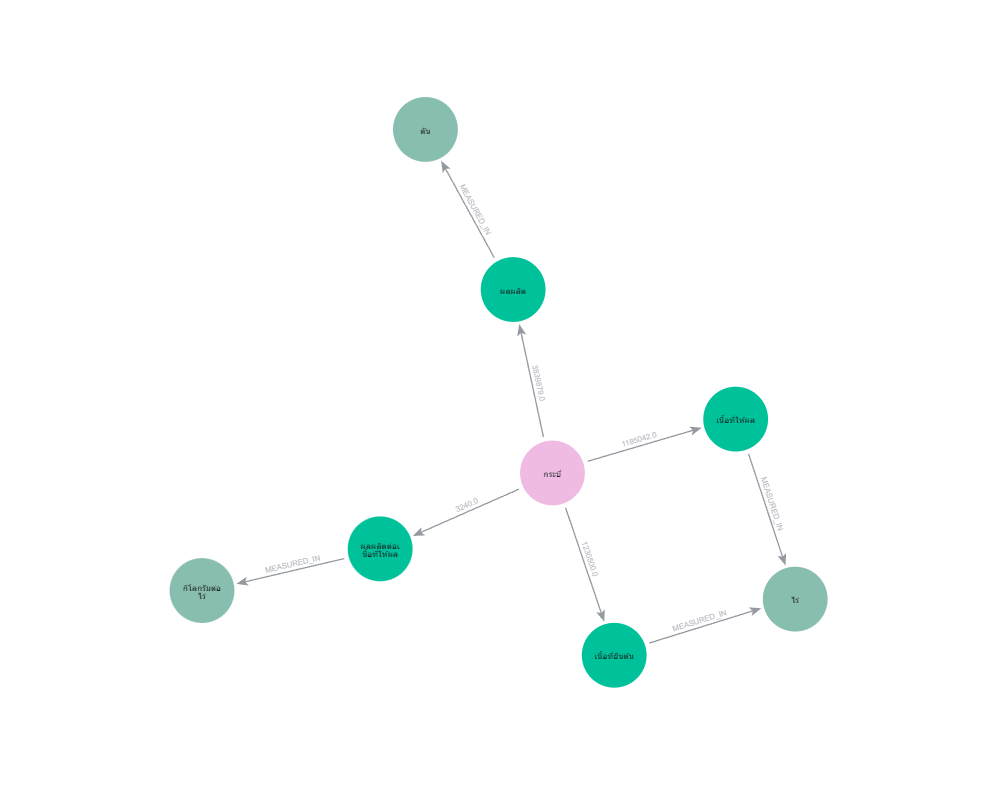

# Section 6.x · Serving Layer (Graph + Semantic Search)

ทำตามเอกสาร `CN230-F3-Section6x-ServingLayer-V3.1` ครบ 4 ขั้น ด้วยข้อมูลปาล์มน้ำมันของทีม และแสดงบนเว็บที่หน้า `/serving-layer`

```
MySQL (Source of Truth) ─Step 1─▶ CSV snapshot ─Step 2─▶ Neo4j graph ─Step 3─▶ Gemini embedding + vector index ─Step 4─▶ semantic search / multi-hop
DASHBOARD/db (plam-oil)  export_csv.py         cypher/02_load_csv      serving.py embed                    DASHBOARD/backend/app/serving/queries.cypher
```

ชั้นนี้ **สร้างใหม่ได้จาก RDBMS เสมอ**: แก้ข้อมูลที่ MySQL เท่านั้น แล้วรัน pipeline ซ้ำ ไม่แก้ใน Neo4j · ไม่มี RAG (ตามที่เอกสารกำหนด)

| ไฟล์ | หน้าที่ |
|---|---|
| `export_csv.py` | Step 1 · ดึง 6 ตารางจาก MySQL เป็น CSV + `snapshot.json` |
| `cypher/01_constraints.cypher`, `cypher/02_load_csv.cypher` | Step 2 · คีย์หลัก → constraint, คีย์นอก → ความสัมพันธ์ |
| `cypher/03_vector_index.cypher` | Step 3 · vector index แบบ cosine |
| `serving.py` | รัน Step 2–4, ตรวจนับ, บันทึกหลักฐาน |
| `DASHBOARD/backend/app/serving/` | query ของ Step 4 + การ embed (ใช้ร่วมกันทั้ง CLI และ API ของเว็บ) |
| `docker-compose.yml` | Neo4j 5 ในเครื่อง |

## วิธีรัน (ในเครื่อง)

ต้องมี Docker Desktop, Python 3.10+ และ `GEMINI_API_KEY` ใน `DASHBOARD/.env` (ไฟล์นี้อยู่ใน .gitignore)

```powershell
cd SERVING_LAYER
python -m venv .venv
.\.venv\Scripts\pip install -r requirements.txt

# MySQL ของ repo (DASHBOARD/db/schema.sql + seed.sql) ที่พอร์ต 3307
docker compose -f ..\DASHBOARD\docker-compose.yml up -d db

# Step 1 · export จาก MySQL
$env:MYSQL_PORT=3307; $env:MYSQL_USER="dashboard_app"; $env:MYSQL_PASSWORD="dashboard_app_pw"
.\.venv\Scripts\python export_csv.py

# Neo4j ในเครื่อง  ->  Browser: http://localhost:7474 (neo4j / palmoil-dev)
docker compose up -d

# Step 2 + 3 + ตรวจนับ
.\.venv\Scripts\python serving.py all

# Step 4 · ลองค้น / บันทึกหลักฐาน
.\.venv\Scripts\python serving.py search "จังหวัดที่เป็นแหล่งปลูกปาล์มน้ำมันหลักทางภาคใต้"
.\.venv\Scripts\python serving.py hop "ผลผลิตปาล์มน้ำมันของจังหวัดแหล่งผลิตหลักในภาคใต้"
.\.venv\Scripts\python serving.py evidence     # ผล Q1–Q3 -> evidence/results.md
```

## Deploy (Neo4j AuraDB Free + Railway + Vercel)

1. สร้าง instance ฟรีที่ Neo4j AuraDB แล้วเก็บ URI (`neo4j+s://xxxx.databases.neo4j.io`) และรหัสผ่าน
2. ใส่ค่าใน `SERVING_LAYER/.env` (gitignored) แล้ว build กราฟบน Aura จากเครื่องเรา:
   ```
   NEO4J_URI=neo4j+s://xxxx.databases.neo4j.io
   NEO4J_USER=neo4j
   NEO4J_PASSWORD=...
   ```
   ```powershell
   .\.venv\Scripts\python serving.py all
   ```
   Aura อ่านไฟล์ในเครื่องเราไม่ได้ `serving.py` จึงส่งแถวจาก CSV ไปเองด้วย `UNWIND $rows AS row` แทน `LOAD CSV` (Cypher ส่วนที่เหลือเหมือนกันทุกบรรทัด)
3. Railway (backend): เปิด service ของ API → แท็บ **Variables** → เพิ่ม `NEO4J_URI`, `NEO4J_USER`, `NEO4J_PASSWORD` (มี `GEMINI_API_KEY` อยู่แล้ว) → กด **Deploy** เพื่อใช้ค่าที่เปลี่ยน
4. Vercel (frontend): ไม่ต้องตั้งอะไรเพิ่ม หน้า `/serving-layer` เรียก API เดิมผ่าน `NEXT_PUBLIC_API_URL`

ข้อควรรู้: Aura Free จะหยุดเองเมื่อไม่มีการใช้งานหลายวัน ต้องเข้าไปกด Resume ก่อน present · ถ้า Neo4j หรือ Gemini ใช้ไม่ได้ หน้าเว็บยังเปิดได้ปกติ แค่ช่องค้นหาสดจะแจ้งว่ายังไม่พร้อม

## ทำงานยังไง

### Step 1 · Export CSV
`export_csv.py` ดึงทุกคอลัมน์ของ 6 ตาราง (รวม `release_id` เพื่อคง provenance) เขียน CSV UTF-8 แบบไม่มี BOM ลง `import/` พร้อม `snapshot.json` (เวลา export + จำนวนแถว) ซึ่งถูกเก็บเป็นโหนด `(:Meta {key:'snapshot'})` ในกราฟด้วย เว็บจึงบอกได้ว่ากราฟสร้างจาก snapshot ไหน

### Step 2 · LOAD CSV … MERGE (FK → relationship)

| FK ใน MySQL | กราฟ | เหตุผล |
|---|---|---|
| `locations.parent_id → locations` | `(:Location)-[:PART_OF]->(:Location)` | ลำดับชั้น จังหวัด → ภาค → ประเทศ |
| `items.unit_id → units` | `(:Item)-[:MEASURED_IN]->(:Unit)` | 1:N |
| `production_stats (location_id, item_id)` | `(:Location)-[:HAS_STAT {stat_id, year, crop_year, value}]->(:Item)` | fact table (M:N) กลายเป็น relationship ที่มี property |
| `production_stats.release_id → data_releases` | property `release_id` บน `HAS_STAT` | ตรวจย้อนไป `(:Release)` ได้ (provenance) |
| `production_stats.commodity_id` | property `commodity_id` บน `HAS_STAT` | มีสินค้าเดียว (ปาล์มน้ำมัน) ไม่คุ้มทำเป็น hop |

ทีมเลือกเก็บ fact เป็น relationship (ไม่แยก `(:Stat)` node) เพื่อให้ตรงกับแนวทางในเอกสาร (`LCI_EXCHANGE` → `EXCHANGES`) และ query สั้นกว่า ผลที่ตามมาคือในภาพ schema โหนด `Release` และ `Commodity` ไม่มีเส้นเชื่อม เพราะเชื่อมผ่าน property แทน
`MERGE` ทำให้รันซ้ำได้โดยไม่เกิดข้อมูลซ้ำ · `serving.py verify` เทียบจำนวนโหนด/ความสัมพันธ์กับจำนวนแถวต้นทาง

### Step 3 · Embedding + vector index

| รายการ | ค่าที่ใช้ |
|---|---|
| โหนดที่ embed | `Location.description` (81 โหนด) และ `Item.description` (4 โหนด) |
| โมเดล | Gemini `gemini-embedding-001` · ข้อความที่เก็บใช้ task `RETRIEVAL_DOCUMENT` (title = ชื่อ) คำถามใช้ `RETRIEVAL_QUERY` |
| มิติ | 768 (`GEMINI_EMBED_DIM`, normalize เป็นความยาว 1) · index ต้องเท่ากัน ถ้าเปลี่ยน `serving.py embed` จะลบ index เก่าแล้วสร้างใหม่ให้ |
| ความคล้าย | cosine |
| วันที่ | เก็บใน `n.embedded_at`, `n.embedding_model` และ `import/snapshot.json` |

เลือก Gemini เพราะ backend ใช้อยู่แล้ว และไม่ต้องรันโมเดล (PyTorch ~1GB) บน server ที่ host backend

**ทำไมไม่ embed แค่ชื่อ:** ชื่อจังหวัดสั้นมาก (ข้อจำกัดที่เอกสารพูดถึง) จึงสร้าง `description` จากข้อมูลในกราฟเอง เช่น
`จังหวัดกระบี่ อยู่ในภาคใต้ Southern region ประเทศไทย. แหล่งปลูกปาล์มน้ำมันหลักของประเทศ ผลผลิตสูงมาก. ผลผลิตปาล์มน้ำมันปี 2567 อันดับ 2 จาก 76 จังหวัด`
ระดับ (หลัก/สำคัญ/น้อย) คำนวณจากอันดับผลผลิตปีล่าสุด จึงสร้างใหม่ได้ทุกครั้งที่ rebuild ส่วน Item ใช้คำอธิบายที่ทีมเขียนเพิ่ม (ไทย+อังกฤษ) ใน `ITEM_GLOSSARY`

### Step 4 · Semantic search + multi-hop
1. คำถามถูก embed ด้วย **โมเดลเดียวกัน** → `$queryVector`
2. `db.index.vector.queryNodes('location_desc', $k, $queryVector)` คืนโหนดที่ cosine ใกล้ที่สุด + `score` (1 = เหมือนมาก)
3. Multi-hop: ใช้ index `item_desc` หาว่าคำถามหมายถึงตัววัดไหน → เดิน `HAS_STAT` ไปเอาค่าปีล่าสุด → `PART_OF` ไปภาค → `MEASURED_IN` ไปหน่วย → จับคู่ `release_id` กับ `(:Release)` เพื่อบอกวันที่เผยแพร่

Query ทั้งหมดอยู่ใน `DASHBOARD/backend/app/serving/queries.cypher` ไฟล์เดียว ใช้ทั้งใน CLI และ API (`/api/graph/search`, `/api/graph/hop`, `/api/graph/status`)

## ตรวจคำตอบกับ RDBMS (คอลัมน์ "ผลที่คาดหวัง")

```sql
-- Q1/Q3: จังหวัดภาคใต้ที่ผลผลิตสูงสุด ปีล่าสุด
SELECT l.name_th, ps.value
FROM production_stats ps
JOIN locations l ON l.location_id = ps.location_id
JOIN locations p ON p.location_id = l.parent_id
JOIN items i ON i.item_id = ps.item_id
WHERE p.name_th = 'ภาคใต้' AND i.item_name = 'ผลผลิต'
  AND ps.crop_year = (SELECT MAX(crop_year) FROM production_stats)
ORDER BY ps.value DESC LIMIT 5;
```

## ผลทดลอง (Gemini, snapshot จาก `mysql:plam-oil`)

รายละเอียดเต็มพร้อมคะแนนอยู่ใน `evidence/results.md` (สร้างด้วย `serving.py evidence`) คะแนนที่ Neo4j รายงานคือ (1 + cosine) / 2

| # | คำถาม | ผลที่คาดหวัง (SQL) | ผลจาก semantic search | สอดคล้อง? |
|---|---|---|---|---|
| Q1 | จังหวัดที่เป็นแหล่งปลูกปาล์มน้ำมันหลักทางภาคใต้ | สุราษฎร์ธานี, กระบี่, ชุมพร, นครศรีธรรมราช, ตรัง | ตรัง, นครศรีธรรมราช, ระนอง, พัทลุง, ชุมพร | บางส่วน: ทั้ง 5 อยู่ภาคใต้ ตรง 3/5 แต่ไม่เจอ 2 อันดับแรก |
| Q2 | How productive are the palm plantations per rai? | ตัววัด ผลผลิตต่อเนื้อที่ให้ผล | ผลผลิตต่อเนื้อที่ให้ผล (อันดับ 1) | ตรง (ถามเป็นภาษาอังกฤษ) |
| Q3 (หลายทอด) | ผลผลิตปาล์มน้ำมันของจังหวัดแหล่งผลิตหลักในภาคใต้ | ผลผลิต (ตัน) ของ 5 จังหวัดข้างต้น ปี 2567 | ตัววัด ผลผลิต ✓ · ปี 2567 ✓ · วันที่เผยแพร่ 2026-07-07 ✓ · จังหวัดตรง 2/5 | บางส่วน: การเดินกราฟถูก แต่การเลือกจังหวัดได้ผลเหมือน Q1 |

ทดสอบเพิ่ม: "ภาคอีสานปลูกปาล์มไหม" ได้จังหวัดภาคอีสานทั้งหมด · "จังหวัดทางเหนือที่แทบไม่ปลูกปาล์ม" ได้ แม่ฮ่องสอน เชียงใหม่ เชียงราย ลำพูน · "พื้นที่ปลูกปาล์มในภาคอีสาน" (หลายทอด) ได้ตัววัด เนื้อที่ยืนต้น (ไร่) ของจังหวัดภาคอีสาน

**ข้อสรุป:** semantic search เก่งเรื่อง "ความหมาย" (ภาค, ตัววัด, ข้ามภาษาไทย–อังกฤษ) แต่ไม่ใช่เครื่องมือจัดอันดับตัวเลข คำถามแบบ "มากที่สุด" ต้องตอบด้วย SQL/Cypher `ORDER BY`

**บั๊กที่เจอและแก้แล้ว:** เดิม query หลายทอดขอ `item_desc` แค่ k=1 แต่ vector index เป็นแบบประมาณ (HNSW) จึงได้ตัววัดผิด (เนื้อที่ยืนต้น แทน ผลผลิต) ตอนนี้ขอทั้ง 4 ตัวแล้วเลือกคะแนนสูงสุด

## ภาพกราฟสำหรับรายงาน/สไลด์ (Neo4j Browser http://localhost:7474)

```cypher
CALL db.schema.visualization();

MATCH path = (p:Location)-[:PART_OF]->(r:Location {name_th: 'ภาคใต้'})-[:PART_OF]->(c:Location)
RETURN path;

MATCH path = (l:Location {name_th: 'กระบี่'})-[s:HAS_STAT {crop_year: 2567}]->(i:Item)-[:MEASURED_IN]->(u:Unit)
RETURN path;
```

| โครงสร้างกราฟ | ลำดับชั้นภาคใต้ | กระบี่ ปี 2567 |
|---|---|---|
|  |  |  |

ผลค้นแบบ vector ใน Browser: รัน `python serving.py vector "คำถาม"` แล้ววางบรรทัด `:param ...` ที่ได้ ก่อนรัน query ใน `queries.cypher`

## Sync, ความเป็นปัจจุบัน และข้อจำกัด
- Rebuild: `export_csv.py` → `serving.py all` (ทำเมื่อมี data release ใหม่จากต้นทาง)
- ระหว่างยังไม่ rebuild ผลอาจล้าหลัง (eventual consistency) → ตรวจด้วย `serving.py verify` และเวลา snapshot ที่หน้าเว็บแสดง
- ข้อจำกัด: ข้อมูลมีแค่ 81 สถานที่ × 4 ตัววัด · ตัวเลขใน description ไม่ได้ทำให้โมเดลเข้าใจค่ามาก/น้อยจริง (จึงใส่ระดับเป็นคำ) · `name_en` ใน DB ยังว่าง · คะแนนของจังหวัดในภาคเดียวกันใกล้กันมาก (ต่างกันหลักทศนิยมที่ 3) อันดับภายในภาคจึงไม่ตรงอันดับผลผลิตจริง แม้ description จะเขียนว่า "แหล่งปลูกหลัก" ไว้แล้ว (Q1 ไม่เจอสุราษฎร์ธานีกับกระบี่) → ต้องเทียบกับ SQL ทุกครั้ง · ต้องมี Gemini API (มีโควตาต่อนาที) ทั้งตอน embed และตอนค้น
